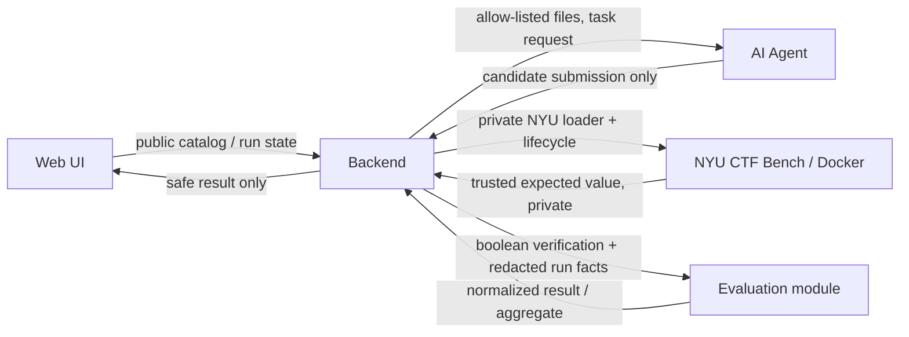
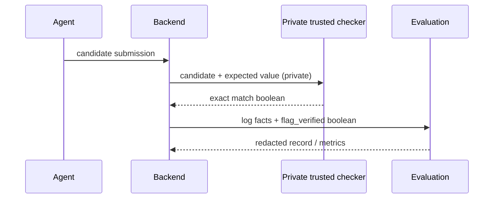

# Module Dataset, Docker & Evaluation

Tài liệu bàn giao kỹ thuật của thành viên 4. Module dùng manifest công khai
làm catalog an toàn, để NYU loader/Docker lifecycle ở backend riêng tư, và
chuẩn hóa kết quả sau khi backend đã kiểm tra flag chính xác.

## Trạng thái đã xác minh

- Dataset khóa ở NYU CTF Bench tag `v20250206`, source commit
  `1dc13a0dc41a71504f727649679e2b5a6d0cb1b1`; development index có 57 challenge.
- `nyuctf==1.1.1` import được trong `.venv-dataset` với Python `3.12.10`.
- Manifest public có ba pilot: `2015q-rev-wyvern`,
  `2016q-cry-sleeping_guard`, `2016q-pwn-warmup`.
- Docker client `29.9.3` và Compose `v5.7.0` có mặt, nhưng Linux Engine không
  truy cập được: pipe `dockerDesktopLinuxEngine` không tồn tại. `wsl --status`
  và `wsl -l -v` trả `Wsl/EnumerateDistros/Service/E_ACCESSDENIED`.
- Các kiểm tra module bên dưới chỉ dùng fixture tổng hợp. Chưa có Docker smoke
  test, dataset clone Linux đầy đủ, Agent run, LLM call, hay benchmark thật.

Xem [STATUS.md](STATUS.md) để biết blocker và điều kiện tiếp tục.

## Kiến trúc và luồng dữ liệu



Flag không đi qua public catalog, Web UI, agent prompt, artifact copy list,
hay evaluation export. Backend giữ expected value từ private NYU metadata và
chỉ truyền boolean `flag_verified` cho normalizer.



## Cấu trúc đã thêm

```text
dataset/manifests/nyu-ctf-bench-v20250206-pilots.public.json  Public source of truth
dataset_evaluation/
  catalog.py        Strict manifest parsing and allow-list lookup
  runtime.py        Prepare/status/cleanup contract, no Docker implementation
  verification.py   Trusted exact matcher (backend-only inputs)
  results.py        NYU-baseline-compatible normalizer and redaction
  metrics.py        Transparent metrics by challenge/category
  exports.py        JSON/CSV export helpers
tests/test_dataset_evaluation.py  Synthetic unit tests only
docs/dataset-evaluation/          This guide and operational status
```

`dataset_evaluation` chỉ dùng Python standard library. Nó không tạo FastAPI,
database, Docker engine, hay một dataset loader mới.

## Dataset và catalog public

Catalog đọc file `dataset/manifests/nyu-ctf-bench-v20250206-pilots.public.json`.
Schema parser chỉ chấp nhận metadata public sau:

```json
{
  "id": "string",
  "name": "string",
  "category": "string",
  "description": "string",
  "agent_files": ["safe-relative-path"]
}
```

Các key như `flag`, `answer`, `secret`, `password`, `api_key`, `token`,
`service`, `container`, hoặc `internal` bị từ chối. `agent_files` chỉ là
allow-list; Backend phải copy đúng file đã được NYU `CTFChallenge` cho phép,
không serialize raw `challenge.json` hay copy compose/service artifact vào
Agent workspace.

```python
from dataset_evaluation.catalog import ChallengeCatalog

catalog = ChallengeCatalog.from_file(
    "dataset/manifests/nyu-ctf-bench-v20250206-pilots.public.json"
)
public_metadata = catalog.get("2016q-pwn-warmup").as_dict()
```

Private worker mới được phép dùng NYU package đã có sẵn:

```python
from nyuctf.challenge import CTFChallenge
from nyuctf.dataset import CTFDataset

dataset = CTFDataset(dataset_json="/linux-private-store/v20250206/development_dataset.json")
challenge = CTFChallenge(dataset.get("2016q-pwn-warmup"), dataset.basedir)
```

Đoạn thứ hai là thiết kế sau khi worker có checkout Linux được xác minh; chưa
được chạy trong trạng thái host hiện tại.

## Contract để Backend, Frontend và Agent tích hợp

Không có HTTP endpoint mới trong nhánh này. Backend có thể map method Python
sau vào endpoint hiện có của nhóm, giữ nguyên JSON contract:

| Operation | Request / method | Public response tối thiểu |
| --- | --- | --- |
| Catalog | `catalog.list_public()` | Mảng metadata năm trường ở trên |
| Lookup | `catalog.get(challenge_id)` | Metadata public hoặc `challenge_not_found` |
| Prepare | `adapter.prepare(challenge_id, run_id=None)` | `run_id`, `challenge`, `state`, `error_code?` |
| Status | `adapter.status(run_id)` | Cùng schema Prepare |
| Cleanup | `adapter.cleanup(run_id)` | Cùng schema, `state: "cleaned"` |

`ChallengeRuntimeAdapter` kiểm tra ID từ catalog trước khi gọi runtime private.
`UnavailableRuntime` trả trạng thái rõ ràng khi Docker/WSL2 hoặc private
checkout chưa sẵn sàng; nó không giả lập server. Backend sau này cài một
`ChallengeRuntime` private bằng NYU lifecycle, không viết lại loader/Docker
compose orchestration.

Resource do runtime tạo phải có prefix `ctf-eval-<run_id>-` và được đăng ký
trong `OwnedResourceRegistry`. Cleanup chỉ lấy candidate thuộc đúng run đã đăng
ký; không enumerate hay xóa Docker resource toàn cục.

Agent chỉ nhận metadata và file trong allow-list. Agent trả candidate
submission cho Backend, không nhận expected flag, raw `challenge.json`, Docker
socket, broad host mount, hay Compose detail. Frontend chỉ hiển thị response
public và run state đã được Backend lọc.

## Đánh giá và flag verification

`verify_flag_exact(submitted_flag, expected_flag)` so sánh exact, không
trim/heuristic. Hai input là private Backend data; object trả về chỉ có
`matched: bool`.

`normalize_baseline_log(...)` chuẩn hóa các trường:

```text
run_id, challenge_id, dataset_version, agent_version, model, attempt,
status, success, duration_seconds, rounds, tool_calls, token_usage,
estimated_cost, failure_type, error_message, category
```

Trường thiếu dùng `null`, không đoán. `raw_log["solved"]` không bao giờ đủ
để `success=True`: chỉ `flag_verified=True` từ trusted checker tạo
`verified_success`. Claim chưa kiểm chứng là `unverified` và bị loại khỏi mẫu
số success rate. Error text redact pattern flag/API key/secret trước export;
raw conversation/log không được export.

`aggregate_records` trả số run, verified/unverified, success rate trên
**verified runs**, duration/rounds/tools trung bình khi có dữ liệu, tổng cost
khi có dữ liệu, failure taxonomy, breakdown challenge/category. Taxonomy gồm
`wrong_flag`, `timeout`, `missing_data`, `challenge_environment`,
`configuration`, `model`, `tool`, `agent`; đây là phân loại vận hành từ error
đã redact, không là kết luận nguyên nhân gốc.

Xuất qua `export_records_json`, `export_records_csv`,
`export_aggregate_json`. Chỉ dùng private/ignored output storage, không chứa
raw agent log hoặc expected flag.

## Thiết lập và kiểm tra đã chạy

Môi trường local dùng Python `3.12.10` và `nyuctf==1.1.1`. Câu lệnh test đã
chạy thành công từ repository root:

```powershell
.\.venv-dataset\Scripts\python.exe -m unittest discover -s tests -v
```

Nó chạy 10 unit tests tổng hợp: manifest pin/ba pilot/no-private-field,
catalog ID thiếu, exact verifier true/false, unverified claim, malformed-log
redaction, metrics, export schema, và cleanup registry chỉ-owned-resource.
Không test nào dùng flag thật, dataset thật, Docker, Agent, hoặc API.

Khi WSL2 được chủ máy cấp quyền, checkout chỉ được đặt trong Linux filesystem
(ví dụ `~/ctf-data`), không phải `/mnt/c` hay `/mnt/d` NTFS vì NYU repository
có filename Windows không checkout được. Venv/package đã xác minh; các lệnh
checkout chính thức sau vẫn cần được chạy và xác minh trên Linux:

```bash
python3 -m venv .venv-dataset
. .venv-dataset/bin/activate
python -m pip install nyuctf==1.1.1
python -m nyuctf.download --version v20250206 --directory ~/ctf-data
git -C ~/ctf-data/v20250206 rev-parse HEAD
```

Commit phải là `1dc13a0dc41a71504f727649679e2b5a6d0cb1b1`. Lệnh tải chưa được
chạy lại trong Mốc 2B vì WSL2 không truy cập được.

## Mốc 2B: điều kiện và smoke test đề xuất

Trước Docker build/pull hoặc đổi storage, cần chủ máy phê duyệt và tự xử lý:
mở/cấp quyền Docker Desktop Linux Engine, sửa WSL2 `E_ACCESSDENIED` nếu cần,
và xác nhận/chuyển Docker Desktop disk image/WSL VHDX sang ổ D:. Ổ C: không
được dùng để tích lũy image cache/VHDX; module không tự di chuyển VHDX/image/
volume, đổi registry/ACL, hay chạy `system prune`.

Read-only check gần nhất quan sát C: còn khoảng 11.35 GiB và D: khoảng
102.86 GiB. Đây không phải dung lượng đã reserve: owner vẫn cần xác nhận
Docker Desktop/WSL sẽ thực sự dùng storage ở D: trước khi pull/build.

Sau khi điều kiện được xác nhận, worker làm **tuần tự**:

1. Read-only kiểm tra daemon/dung lượng, checkout dataset Linux private, verify
   tag/commit/metadata/files ba pilot.
2. `2015q-rev-wyvern`: kiểm tra metadata/file allow-list và staging tách biệt.
3. `2016q-cry-sleeping_guard`: validate Compose, tạo resource prefix run,
   start một service, readiness/DNS/protocol check, log redact, teardown run.
4. `2016q-pwn-warmup`: lặp lại sau cleanup Sleeping Guard, không chạy song
   song để tránh xung đột port.

Smoke test không chạy Agent/LLM, không bind Docker socket vào agent container,
không broad host mount, và có CPU/memory/time limit theo NYU/owner phê duyệt.
Chỉ sau smoke xanh và API cost budget rõ ràng mới chạy baseline thật; D-CIPHER
không được gọi là NYU paper baseline.

## Khắc phục sự cố hiện biết

| Hiện tượng | Sự thật đã quan sát | Hành động an toàn |
| --- | --- | --- |
| Docker daemon unavailable | `docker version` không thấy pipe Linux Engine | Chủ máy kiểm tra Docker Desktop; module không đổi quyền/cấu hình hay restart môi trường khác. |
| WSL access denied | `Wsl/EnumerateDistros/Service/E_ACCESSDENIED` | Chủ máy/administrator xử lý WSL; không reinstall/update từ repo task. |
| Clone NYU trên NTFS lỗi tên file | Git for Windows không checkout tên chứa `?` | Dùng Linux filesystem WSL, không dùng `/mnt/c`/`/mnt/d`. |
| Dung lượng C: hạn chế | Không pull/build trước khi xác nhận storage Docker/WSL trên D: | Owner phê duyệt vị trí storage và headroom. |

Không ghi API key, flag, expected answer hoặc artifact private vào Git, log,
manifest, CSV/JSON export hay UI. Mọi lệnh thay đổi host/system cần phê duyệt
chủ máy trước khi thực hiện.
